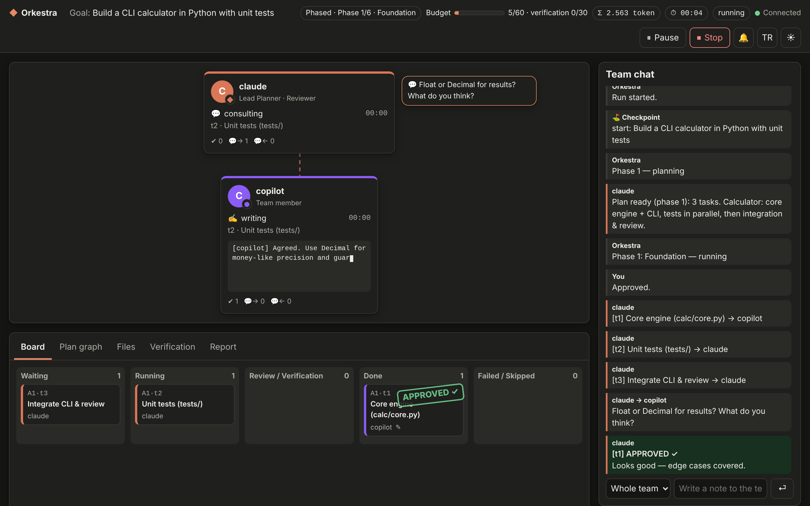
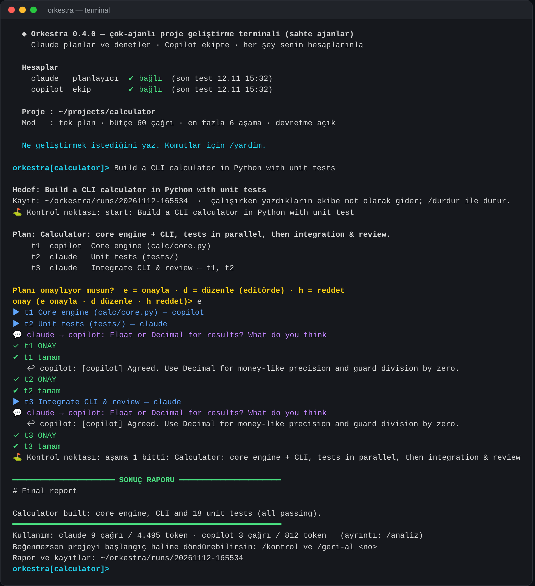
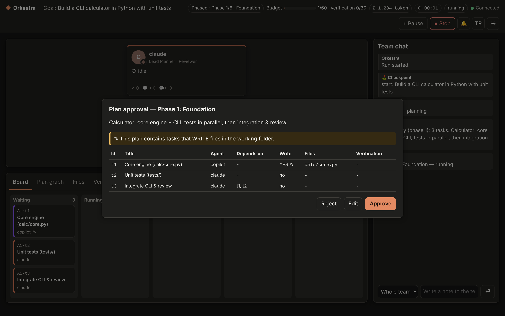
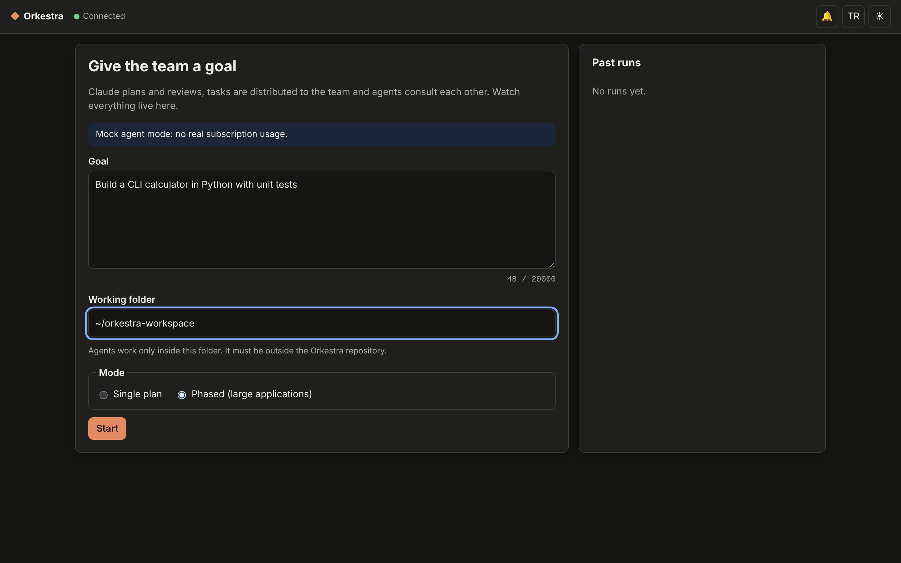
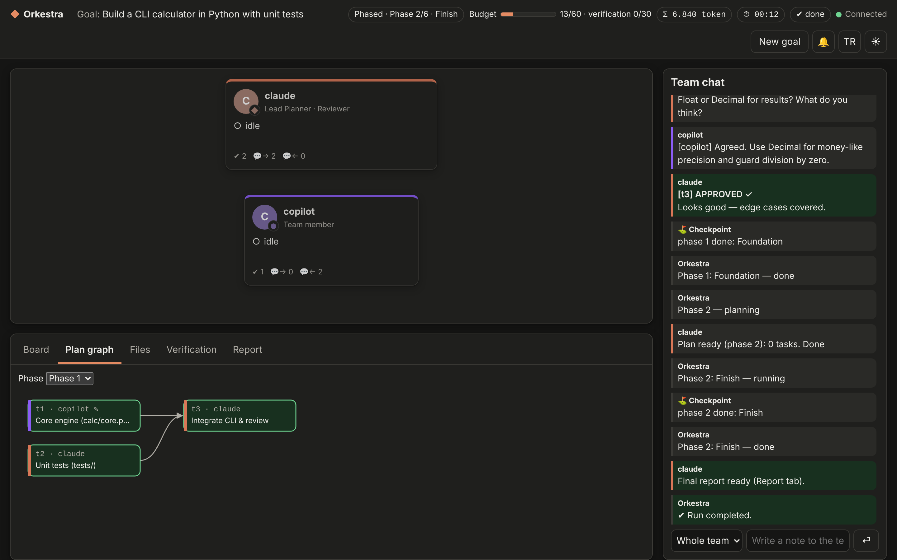

# Orkestra

**Orkestra** is a multi-agent orchestrator that runs **Claude Code**, **Gemini CLI** and **GitHub Copilot CLI** as a single development team, using **your own subscriptions** through their official command-line tools.

Claude plans the work and reviews every result. Tasks are split up and handed to whichever agent fits best, independent tasks run in parallel, and agents can ask each other questions while they work. Tests are run by Orkestra itself, not by the agents, and failures go back to the agent automatically.

> Türkçe belge: [README.md](README.md) · Detailed usage guide (Turkish): [KULLANIM.md](KULLANIM.md)
>
> Note: the terminal app currently speaks **Turkish**; the web workspace has an **EN/TR** switch.



<sub>Screenshots were taken with mock agents (`--mock`, Claude + Copilot team), which use no subscription quota.</sub>

## Why?

- **Use the subscriptions you already pay for.** No API keys and no extra billing. Each tool signs in through its own official login, and Orkestra stores no passwords.
- **A second pair of eyes.** Every task output is reviewed before it counts as done.
- **Tests that actually run.** Verification commands come only from your config (for example `python -m unittest`). Orkestra runs them, and failing output is fed back to the agent for a fix.
- **A safety net.** Checkpoints are kept outside your own `.git`, so you can diff and roll back (`/fark`, `/geri-al`). Protected paths (`.git`, `.claude`, `CLAUDE.md` and others) stop the run if they are touched. Only one agent writes at a time.
- **Quota-aware.** If one agent hits its limit, the task is handed over to another one. Runs can be resumed later.
- **Transparent cost.** Per-agent call and token counts are shown after every run, and `orkestra analiz` explains where the tokens went.

## Two ways to work

| Terminal (project development REPL) | Web workspace (localhost only) |
|---|---|
|  |  |

| Start screen | Finished run, plan graph |
|---|---|
|  |  |

## Quick start

**Requirements:** Python 3.11+ · Node.js LTS · Claude Pro (required, it's the planner). Gemini and GitHub Copilot are optional.

```bash
git clone https://github.com/Realfoxxy/AI-Operator.git orkestra
```

```bash
cd orkestra
```

Install the official CLIs and sign in to each one once:

```bash
npm install -g @anthropic-ai/claude-code @google/gemini-cli @github/copilot
```

Try it without spending any quota (mock agents):

```bash
python3 -m orkestra --mock
```

Start for real:

```bash
python3 -m orkestra
```

On Windows, use `.\orkestra.cmd` instead of `python -m orkestra`; it picks the right Python version for you. The setup helpers `kur.sh` / `kur.ps1` check your environment and offer to install anything that's missing.

Inside the terminal, `/hizli ac` turns on fast mode for small tasks (fewer planning and review calls). `/katalog` lists optional extra team members (more Claude workers, OpenAI Codex, Qwen Code, Cursor, local Ollama), and `/yardim` shows all commands.

## Honest notes

- Orchestration is **not** automatically cheaper than a single agent: planning and review are extra calls. For tiny tasks use fast mode or a single agent. Orkestra pays off when work can be split, when a review catches mistakes, or when one subscription's quota isn't enough.
- Verification commands run code written by AI **on your machine**. For untrusted work, use a VM, WSL or Windows Sandbox, or the built-in Docker sandbox (`sandbox = "docker"`).
- It is built on pure Python with no dependencies. It is a young project (v0.4), and feedback and issues are welcome.

## License

MIT, see [LICENSE](LICENSE).
