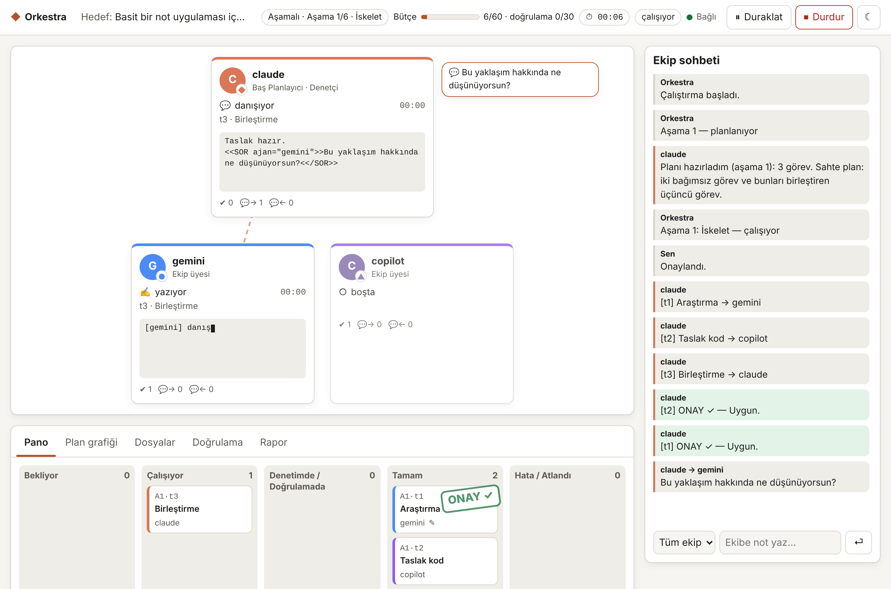
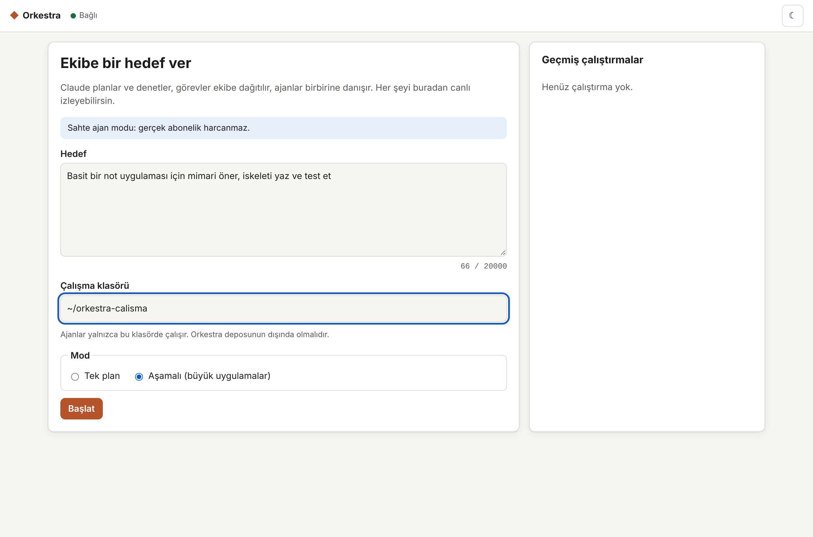
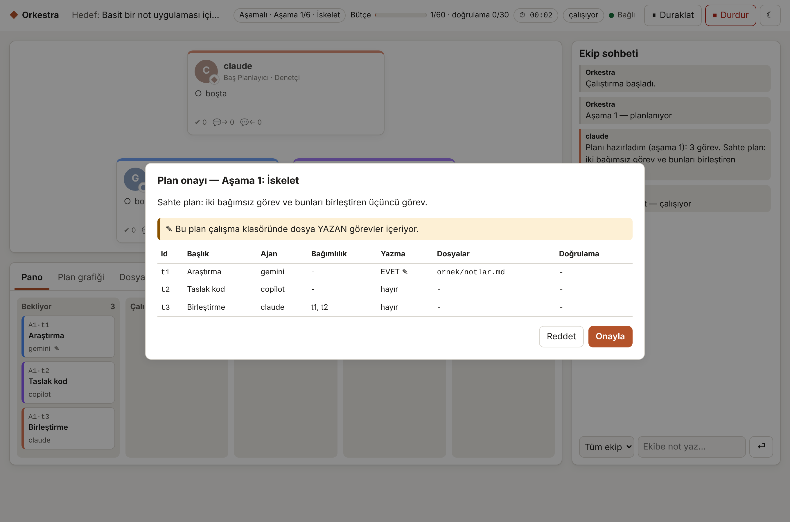
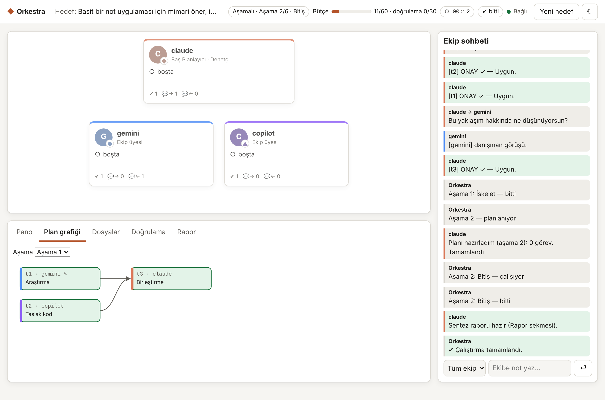

# Orkestra

**Orkestra** — Claude, Gemini ve GitHub Copilot'u tek bir ekip gibi çalıştıran çok-ajanlı orkestratör. Claude planlar ve denetler; görevler paralel dağıtılır; ajanlar birbirine danışır. Resmi CLI araçlarını kullandığı için mevcut aboneliklerinle çalışır. Ajanların çalışmasını canlı izleyebileceğin görsel bir çalışma alanı ve büyük uygulamalar için aşamalı planlama içerir. Saf Python, sıfır bağımlılık, güvenlik öncelikli tasarım. Ayrıntılar için [DOKUMANTASYON.md](DOKUMANTASYON.md).



<sub>Ekran görüntüleri `python -m orkestra ui --mock` ile sahte ajanlarla alınmıştır.</sub>

## Proje geliştirme terminali

```
$ orkestra
  ◆ Orkestra 0.3.0 — çok-ajanlı proje geliştirme terminali
  Hesaplar
    claude   planlayıcı  ✔ bağlı
    gemini   ekip        ✔ bağlı
    copilot  ekip        ✔ bağlı

orkestra[not-uygulamasi]> Python ve SQLite ile bir not uygulaması yaz, testlerini de yaz.
━━ Aşama 1 planlanıyor…
Plan — İskelet: Klasör yapısı, veri katmanı ve testler
    t1  claude   Mimari ve iskelet  ✎ src/, docs/mimari.md
    t2  copilot  Veri katmanı testleri  ✎ tests/  🧪 pytest
    t3  gemini   Kullanım belgesi  ✎ README.md
onay (e onayla · d düzenle · h reddet)> e
▶ t1 Mimari ve iskelet — claude
💬 copilot → claude: Veritabanı dosyası nerede tutulmalı?
🧪 t2 pytest ✓  (1.4 sn, çıkış 0)
✓ t1 ONAY
⛳ Kontrol noktası: aşama 1 bitti: İskelet
…
```

Herkes **kendi** Claude Pro, Google AI Pro ve GitHub Copilot hesabını bağlar (`/baglan`). Orkestra hiçbir şifre saklamaz; giriş her aracın resmi ekranıyla yapılır. Ayrıntılı anlatım: **[KULLANIM.md](KULLANIM.md)**.

## Neler yapar?

- **Planlama ve dağıtım:** Claude hedefi en fazla 8 göreve böler, her görevi en uygun ajana atar; bağımsız görevler paralel çalışır.
- **Danışma:** Ajanlar görev sırasında birbirine soru sorabilir (`<<SOR ajan="gemini">>…<</SOR>>`).
- **Denetim:** Her görev çıktısını Claude denetler; gerekirse revizyon ister. En sonda tek bir sentez raporu yazar.
- **Aşamalı mod:** Büyük uygulamalarda iş aşama aşama planlanır; her aşama projenin gerçek durumuna göre planlanır, proje hafızası tutulur.
- **Doğrulama:** Testleri ajanlar değil Orkestra çalıştırır; yalnızca senin config'te tanımladığın komutlar.
- **Kaldığı yerden devam:** Kota biterse veya bilgisayar kapanırsa `devam` ile sürdürülür.
- **Görsel çalışma alanı:** Ajan masaları, canlı yazma akışı, danışma okları, ekip sohbeti, görev panosu, plan grafiği, dosya ve doğrulama panelleri, onay pencereleri.
- **Güvenlik ağı (0.3):** Her aşamada kontrol noktası; `/fark` ve `/geri-al` ile geri dönüş. Bu işlem kullanıcının kendi `.git` deposuna dokunmaz.
- **Devretme (0.3):** Bir ajanın kotası dolarsa görev otomatik olarak başka ajana geçer.
- **Plan düzenleme (0.3):** Onaylamadan önce görevi başka ajana ata, talimatı değiştir.
- **Sıkı mod ve Docker yalıtımı (0.3):** Kesin değişiklik takibi; testler ağsız kapsayıcıda.
- **Kullanım göstergesi, oturum sürekliliği, bildirimler ve İngilizce arayüz (0.3).**

## Hızlı kurulum

**Gereksinimler:** Python 3.11+ · Node.js LTS · Claude Pro (planlayıcı için zorunlu), isteğe bağlı Google AI Pro ve GitHub Copilot.

### Seçenek A — İndir ve çalıştır (önerilen)

Orkestra hiçbir Python paketi gerektirmez; indirip çalıştırman yeterli.

```bash
git clone https://github.com/Realfoxxy/AI-Operator.git orkestra
```

```bash
cd orkestra
```

Git kullanmıyorsan [Releases](https://github.com/Realfoxxy/AI-Operator/releases) sayfasından son sürümün ZIP dosyasını indirip açabilirsin.

Ardından kurulum yardımcısını çalıştır. Python ve Node'u denetler, eksik CLI'ları kurmayı **önerir** (onay vermezsen hiçbir şey kurmaz), testleri ve `doctor` denetimini çalıştırır:

- **Linux / macOS:**

  ```bash
  bash kur.sh
  ```

- **Windows (PowerShell):**

  ```powershell
  powershell -ExecutionPolicy Bypass -File .\kur.ps1
  ```

### Seçenek B — pipx ile komut olarak kur

```bash
pipx install git+https://github.com/Realfoxxy/AI-Operator.git
```

Bu durumda komut `orkestra` olur (`python -m orkestra` yerine). İlk çalıştırmada config dosyası kullanıcı klasörüne yazılır: Linux/macOS'ta `~/.config/orkestra/config.toml`, Windows'ta `%APPDATA%\Orkestra\config.toml`. Varsayılan çalışma klasörü `~/orkestra-calisma` olur. Başka bir config için `ORKESTRA_CONFIG` ortam değişkenini veya `--config` bayrağını kullan.

### CLI araçlarına bir kez giriş yap

```bash
npm install -g @anthropic-ai/claude-code @google/gemini-cli @github/copilot
```

| Araç | Komut | Giriş |
|---|---|---|
| Claude Code | `claude` | Claude hesabıyla (Pro) |
| Gemini CLI | `gemini` | "Login with Google" |
| Copilot CLI | `copilot` | İçeride `/login` |

Copilot CLI, kullanılacak çalışma klasörüne bir kez güven onayı ister: `cd ../orkestra-calisma` ve ardından `copilot`.

Kullanmak istemediğin ajanı `config.toml` içinde `enabled = false` ile kapatabilirsin.

## Kullanım

Proje geliştirme terminali (önerilen başlangıç):

```bash
python -m orkestra
```

Abonelik harcamadan dene (sahte ajanlar):

```bash
python -m orkestra --mock
```

Hesapları terminal açmadan bağla:

```bash
python -m orkestra hesap
```

Görsel çalışma alanı (tarayıcıda açılır, yalnızca `127.0.0.1`):

```bash
python -m orkestra ui
```

Komut satırından:

```bash
python -m orkestra run "Basit bir yapılacaklar uygulaması için mimari öner ve iskeleti yaz"
```

Büyük bir uygulama için aşamalı mod:

```bash
python -m orkestra run --asamali "..."
```

Yarım kalan bir çalıştırmayı sürdür:

```bash
python -m orkestra devam runs/20261111-183929
```

Kurulum denetimi:

```bash
python -m orkestra doctor
```

Diğer seçenekler: `--workspace <klasör>`, `--hedef-dosyasi hedef.txt`, `--yes` (yalnızca salt-okunur planları otomatik onaylar), `--ui` (`run` ve `devam` için), `ui --port 9000 --no-browser`.

| Başlangıç | Plan onayı | Sonuç ve plan grafiği |
|---|---|---|
|  |  |  |

Her çalıştırmanın kayıtları `runs/<zaman>/` altındadır: `plan.json`, `gorev-*.md`, `sonuc.md`, `kayit.jsonl` ve `durum.json`.

## Güvenlik özeti

- Kabuk kullanılmaz; istem hiçbir zaman komut satırı argümanı olmaz.
- Ajanlar yalnızca çalışma klasöründe çalışır. Bu klasör Orkestra deposunun **dışında** olmalıdır (varsayılan `../orkestra-calisma`).
- Dosya yazan planlar her zaman onay ister. Aynı anda tek ajan yazar.
- `.claude/`, `.git/`, `CLAUDE.md` gibi ajanlara yetki verebilecek yollar korunur; değişirse çalıştırma durur ve sana sorulur.
- Doğrulama komutları ajanların yazdığı kodu **senin bilgisayarında** çalıştırır. Güvenmediğin işlerde Orkestra'yı sanal makine, WSL veya Windows Sandbox içinde çalıştır.
- Web arayüzü yalnızca `127.0.0.1`'e bağlanır; oturum token'ı, Host/Origin denetimi ve sıkı CSP kullanır.
- `runs/` klasörü tüm istem ve cevapları içerir. **Asla commit etme** (`.gitignore` içinde).

Tüm kurallar için [DOKUMANTASYON.md bölüm 8](DOKUMANTASYON.md#8-güvenlik-gereksinimleri).

## Geliştirme

```bash
python -m unittest -v
```

Testler gerçek CLI veya ağ erişimi gerektirmez. GitHub Actions her push'ta testleri Linux, macOS ve Windows üzerinde çalıştırır.

## Lisans

[MIT](LICENSE)
